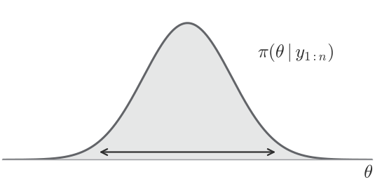

## The traditional Bayesian recipe

::: {style="padding-top: 1em"}
**Step 1 - Obtain the posterior via Bayesian rule**

$\displaystyle \pi(\theta \mid y_{1:n}) \;\propto\; \pi(\theta) \prod_{i=1}^{n} f(y_i \mid \theta)$
:::

::: {style="padding-top: 1em"}
**Step 2 - Average the likelihood over the posterior to predict new points**

$\displaystyle p(y_{n+1} \mid y_{1:n}) = \int f(y_{n+1} \mid \theta)\, \pi(\theta \mid y_{1:n})\, d\theta$
:::

::: {style="padding-top: 1em"}
**Known shortcomings of traditional Bayes**

- specification of prior $\pi(\theta)$ and likelihood $f(y_{n+1} \mid \theta)$ often challenging
- often computationally expensive approximations (e.g. MCMC) are necessary
:::

## Predictive Bayesian Inference
[In predictive Bayes a posterior is derived without specifying a prior or a likelihood]{.subtitle}

::: {style="padding-top: 2em; font-size: 0.85em"}
::: box
$$
\begin{array}{ccccccc}
  & & \mathclap{\textbf{Traditional Bayesian Inference}} & & & & \\[1em]
\underset{\text{likelihood}}{f(y \mid \theta)},\ \underset{\text{prior}}{\pi(\theta)}
  & \xrightarrow[\text{Bayes}]{\qquad\quad}
  & \underset{\text{posterior}}{\pi(\theta \mid y_{1:n})}
  & \xrightarrow[\text{predictive}]{\qquad\quad}
  & \underset{\text{posterior predictive}}{p(y \mid y_{1:n})}
  & & \\[-1.2em]
  & & \hphantom{\underset{\text{martingale posterior}}{\pi(\theta \mid y_{1:n})}}
  & \hphantom{\xleftarrow[\text{impute new observations}]{\qquad\quad}}
  & \hphantom{\underset{\substack{\text{predictive density}\\\text{after observing data}}}{p(y \mid y_{1:n})}}
  & \hphantom{\xleftarrow[\text{observe } y_{1:n}]{\qquad\quad}}
  & \hphantom{\underset{\substack{\text{initial}\\\text{predictive density}}}{p(y)}}
\end{array}
$$
:::

::: {.box style="margin-top: 2em"}
$$
\begin{array}{ccccccc}
  & & & & \mathclap{\textbf{Predictive Bayesian Inference}} & & \\[1em]
  & & \underset{\text{martingale posterior}}{\pi(\theta \mid y_{1:n})}
  & \xleftarrow[\text{impute new observations}]{\qquad\quad}
  & \underset{\substack{\text{predictive density}\\\text{after observing data}}}{p(y \mid y_{1:n})}
  & \xleftarrow[\text{observe } y_{1:n}]{\qquad\quad}
  & \underset{\substack{\text{initial}\\\text{predictive density}}}{p(y)} \\[-1.2em]
\hphantom{\underset{\text{likelihood}}{f(y \mid \theta)},\ \underset{\text{prior}}{\pi(\theta)}}
  & \hphantom{\xrightarrow[\text{Bayes}]{\qquad\quad}}
  & \hphantom{\underset{\text{posterior}}{\pi(\theta \mid y_{1:n})}}
  & \hphantom{\xrightarrow[\text{predictive}]{\qquad\quad}}
  & \hphantom{\underset{\text{posterior predictive}}{p(y \mid y_{1:n})}}
  & &
\end{array}
$$
:::
:::

::: {style="text-align: right; padding-top: 1.5em"}
[Diagram adapted from Fong, Holmes & Walker (2023), *Martingale posterior distributions*, JRSS B.]{.source}
:::

## Table of Contents

::: {.agenda style="padding-top: 1em"}
1. Perspectives on Bayesian Uncertainty
2. Predictive Bayesian Framework
   1. Traditional Bayesian inference in the predicitve framework.
   2. Generalizing from traditional Bayes in the predictive framework
3. Martingale Posteriors
   1. Conditions that shall be fullfilled
   2. ???
4. Practical Application
:::

## {.question}

Where does Bayesian uncertainty come from?

## Bayesian Perspectives on Uncertainty
[Where does the uncertainty represented by the posterior come from?]{.subtitle}

{.nostretch width=45% fig-align="center"}

:::: {.columns style="padding-top: 1em"}
::: {.column width="49%"}
::: box
[**Traditional Bayesian view**]{style="color: #2F2F2F"}

Uncertainty comes from treating $\theta$ as random, drawn from the prior $\pi$.
:::
:::
::: {.column width="2%"}
:::
::: {.column width="49%"}
::: {.box .fragment .custom .focus-outline}
[**Predictive Bayesian view**]{style="color: #2F2F2F"}

Uncertainty stems from our lack of knowledge about the missing data $y_{n+1:\infty}$.
:::
:::
::::

## Doob's Theorem
[With infinite data, we could determine the parameter $\Theta$ exactly]{.subtitle}

::: {.box style="margin-top: 2em"}
[**Theorem (Doob, 1949)**]{style="color: #2F2F2F"}

Let $\Theta \sim \Pi$ with $E[|\Theta|] < \infty$ and $Y_1, Y_2, \dots \mid \Theta \overset{iid}{\sim} f_\Theta$.

Under measurability and identifiability conditions on $f_\theta$,

$$
\bar\theta_N = E[\Theta \mid Y_{1:N}] \;\longrightarrow\; \Theta \quad \text{a.s.} \qquad \text{for } N \to \infty
$$
:::

::: {style="padding-top: 1em"}
::: fragment
- We only observe a fixed sample $y_{1:n}$ instead of an infinite sequence $Y_{1:\infty}$, so we cannot pinpoint $\Theta$ exactly
:::

::: fragment
[Uncertainty about the actual value of $\Theta$ due to the fact that the realizations $Y_{n+1:\infty}$ are missing]{.then}
:::
:::

::: {.fragment style="padding-top: 1.5em; text-align: center; font-weight: 700; color: #2F2F2F"}
So how do we generate realizations of $Y_{n+1:\infty}$?
:::

## Predictive resampling
[The missing observations $Y_{n+1:\infty}$ are simulated up to a large horizon $N$]{.subtitle}

::: {.box style="margin-top: 2em; font-size: 0.9em; --r-block-margin: 17px"}
[**Algorithm - Predictive Resampling**]{style="color: #2F2F2F"}

**Given:** observed data $y_{1:n}$, initial predictive $p(\cdot \mid y_{1:n})$, update rule, sampling paths $B$, horizon $N$

For $b = 1, \dots, B$:

::: {style="padding-left: 1.5em"}
For $i = n+1, \dots, N$:

::: {style="padding-left: 1.5em"}
[[▷]{style="font-size: 0.7em; margin-right: 0.4em"}simulate the next observation]{style="float: right; width: 25em; text-align: left; color: #8C8C8C"}Sample $\tilde y_i \sim p(\cdot \mid y_{1:n}, \tilde y_{n+1:i-1})$

[[▷]{style="font-size: 0.7em; margin-right: 0.4em"}update the predictive based on the new observation]{style="float: right; width: 25em; text-align: left; color: #8C8C8C"}Update $p(\cdot \mid y_{1:n}, \tilde y_{n+1:i-1}) \mapsto p(\cdot \mid y_{1:n}, \tilde y_{n+1:i})$
:::

[[▷]{style="font-size: 0.7em; margin-right: 0.4em"}compute the parameter of interest given the “full” data]{style="float: right; width: 25em; text-align: left; color: #8C8C8C"}$\theta_N^{(b)} = \theta(y_{1:n}, \tilde y_{n+1:N})$
:::

Return $\theta_N^{(1)}, \dots, \theta_N^{(B)}$, with $\theta_N^{(b)} \approx \theta_\infty^{(b)}$ for large $N$
:::

::: {style="text-align: right; padding-top: 1em"}
[Algorithm adapted from Fong, Holmes & Walker (2023); notation following Battaglia et al. (2026), *Variational predictive resampling*, arXiv:2605.11168.]{.source}
:::

## Predictive Resampling Framework - Demonstration
[Each path imputes future data; the limits form the posterior]{.subtitle}

<iframe class="embed" src="resources/martingale_posterior.html?embed"></iframe>

## {.answer}

::: qa
[Where does Bayesian uncertainty come from?]{.asked}

[From the missing observations $Y_{n+1:\infty}$, which we can simulate using predictive resampling]{.then}
:::

## {.question}

How to express the traditional Bayesian model in the predictive resampling framework?

# Making the predictive resampling framework explicit
[The framework is made explicit by three design choices]{.subtitle}

:::: {style="display: flex; align-items: flex-start; gap: 3em; margin-top: 2em"}
::: {.box style="margin: 0; width: fit-content; flex: none; font-size: 0.9em; --r-block-margin: 17px"}
[**Algorithm - Predictive Resampling**]{style="color: #2F2F2F"}

**Given:** $y_{1:n}$, $\textcolor{#00883A}{p(\cdot \mid y_{1:n})}$, $B$, $N$

For $b = 1, \dots, B$:

::: {style="padding-left: 1.5em"}
For $i = n+1, \dots, N$:

::: {style="padding-left: 1.5em"}
Sample $\tilde y_i \sim p(\cdot \mid y_{1:n}, \tilde y_{n+1:i-1})$

Update $\textcolor{#D9822B}{p(\cdot \mid y_{1:n}, \tilde y_{n+1:i-1}) \mapsto p(\cdot \mid y_{1:n}, \tilde y_{n+1:i})}$
:::

$\theta_N^{(b)} = \textcolor{#2F6DB5}{\theta}(y_{1:n}, \tilde y_{n+1:N})$
:::

Return $\theta_N^{(1)}, \dots, \theta_N^{(B)}$
:::

::: {style="font-size: 0.9em; --r-block-margin: 30px; margin-top: -13px"}
**Design choices**[\
**Traditional Bayesian Inference (posterior mean)**]{.fragment .collapse fragment-index="1"}

[**(1)** Initial Predictive Density]{style="color: #00883A"}\
[$p(\tilde y_{n+1} \mid y_{1:n}) = \int f(\tilde y_{n+1} \mid \theta)\, \pi(\theta \mid y_{1:n})\, d\theta$]{.fragment .collapse fragment-index="1" style="color: #2F2F2F; display: inline-block; margin-top: 0.35em; font-size: 0.82em"}

[**(2)** Update Rule for the Predictive Density]{style="color: #D9822B"}\
[$\pi(\theta \mid y_{1:n}, \tilde y_{n+1:i}) = \dfrac{f(\tilde y_i \mid \theta)\, \pi(\theta \mid y_{1:n}, \tilde y_{n+1:i-1})}{p(\tilde y_i \mid y_{1:n}, \tilde y_{n+1:i-1})}$\
$p(\tilde y_{i+1} \mid y_{1:n}, \tilde y_{n+1:i}) = \int f(\tilde y_{i+1} \mid \theta)\, \pi(\theta \mid y_{1:n}, \tilde y_{n+1:i})\, d\theta$]{.fragment .collapse fragment-index="1" style="color: #2F2F2F; display: inline-block; margin-top: 0.35em; font-size: 0.82em; line-height: 2.1"}

[**(3)** Statistic of Interest]{style="color: #2F6DB5"}\
[$\theta(y_{1:n}, \tilde y_{n+1:N}) = E[\Theta \mid y_{1:n}, \tilde y_{n+1:N}]$]{.fragment .collapse fragment-index="1" style="color: #2F2F2F; display: inline-block; margin-top: 0.35em; font-size: 0.82em"}
:::
::::

## Predictive Resampling - Traditional Bayesian Inference
[With the Bayesian design choices, the endpoints recover the posterior $\pi(\theta \mid y_{1:n})$]{.subtitle}

<iframe class="embed" src="resources/martingale_posterior.html?embed&frozen" style="height: 560px"></iframe>

::: {style="padding-top: 0.6em"}
[Can we go beyond the likelihood $\times$ prior construction?]{.then}
:::

# What are the implications?
## Backup: Predictive Resampling (with predictive densities) {visibility="uncounted"}
[Original demo: path 1 pauses after 25 observations; hover shows the predictive density]{.subtitle}

<iframe class="embed" src="resources/martingale_posterior_full.html?embed"></iframe>
