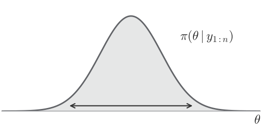
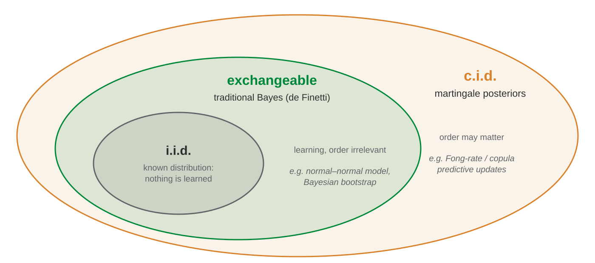

## The traditional Bayesian recipe

::: {style="padding-top: 1em"}
**Step 1 - Obtain the posterior via Bayesian rule**

$\displaystyle \pi(\theta \mid y_{1:n}) \;\propto\; \pi(\theta) \prod_{i=1}^{n} f(y_i \mid \theta)$
:::

::: {style="padding-top: 1em"}
**Step 2 - Average the likelihood over the posterior to predict new points**

$\displaystyle p(y_{n+1} \mid y_{1:n}) = \int f(y_{n+1} \mid \theta)\, \pi(\theta \mid y_{1:n})\, d\theta$
:::

::: {style="padding-top: 1em"}
**Known shortcomings of traditional Bayes**

- specification of prior $\pi(\theta)$ and likelihood $f(y_{n+1} \mid \theta)$ often challenging
- often computationally expensive approximations (e.g. MCMC) are necessary
:::

## Predictive Bayesian Inference
[In predictive Bayes a posterior is derived without specifying a prior or a likelihood]{.subtitle}

::: {style="padding-top: 2em; font-size: 0.85em"}
::: box
$$
\begin{array}{ccccccc}
  & & \mathclap{\textbf{Traditional Bayesian Inference}} & & & & \\[1em]
\underset{\text{likelihood}}{f(y \mid \theta)},\ \underset{\text{prior}}{\pi(\theta)}
  & \xrightarrow[\text{Bayes}]{\qquad\quad}
  & \underset{\text{posterior}}{\pi(\theta \mid y_{1:n})}
  & \xrightarrow[\text{predictive}]{\qquad\quad}
  & \underset{\text{posterior predictive}}{p(y \mid y_{1:n})}
  & & \\[-1.2em]
  & & \hphantom{\underset{\text{martingale posterior}}{\pi(\theta \mid y_{1:n})}}
  & \hphantom{\xleftarrow[\text{impute new observations}]{\qquad\quad}}
  & \hphantom{\underset{\substack{\text{predictive density}\\\text{after observing data}}}{p(y \mid y_{1:n})}}
  & \hphantom{\xleftarrow[\text{observe } y_{1:n}]{\qquad\quad}}
  & \hphantom{\underset{\substack{\text{initial}\\\text{predictive density}}}{p(y)}}
\end{array}
$$
:::

::: {.box style="margin-top: 2em"}
$$
\begin{array}{ccccccc}
  & & & & \mathclap{\textbf{Predictive Bayesian Inference}} & & \\[1em]
  & & \underset{\text{martingale posterior}}{\pi(\theta \mid y_{1:n})}
  & \xleftarrow[\text{impute new observations}]{\qquad\quad}
  & \underset{\substack{\text{predictive density}\\\text{after observing data}}}{p(y \mid y_{1:n})}
  & \xleftarrow[\text{observe } y_{1:n}]{\qquad\quad}
  & \underset{\substack{\text{initial}\\\text{predictive density}}}{p(y)} \\[-1.2em]
\hphantom{\underset{\text{likelihood}}{f(y \mid \theta)},\ \underset{\text{prior}}{\pi(\theta)}}
  & \hphantom{\xrightarrow[\text{Bayes}]{\qquad\quad}}
  & \hphantom{\underset{\text{posterior}}{\pi(\theta \mid y_{1:n})}}
  & \hphantom{\xrightarrow[\text{predictive}]{\qquad\quad}}
  & \hphantom{\underset{\text{posterior predictive}}{p(y \mid y_{1:n})}}
  & &
\end{array}
$$
:::
:::

::: {style="text-align: right; padding-top: 1.5em"}
[Diagram adapted from Fong, Holmes & Walker (2023), *Martingale posterior distributions*, JRSS B.]{.source}
:::

## Table of Contents

::: {.agenda style="padding-top: 1em"}
1. Perspectives on Bayesian Uncertainty
2. Predictive Bayesian Framework
   1. Traditional Bayesian inference in the predicitve framework.
   2. Generalizing from traditional Bayes in the predictive framework
3. Martingale Posteriors
   1. Conditions that shall be fullfilled
   2. ???
4. Practical Application
:::

## {.question}

Where does Bayesian uncertainty come from?

## Bayesian Perspectives on Uncertainty
[Where does the uncertainty represented by the posterior come from?]{.subtitle}

{.nostretch width=40% fig-align="center"}

:::: {.columns style="margin-top: -0.5em"}
::: {.column width="49%"}
::: box
[**Traditional Bayesian view**]{style="color: #2F2F2F"}

- $\theta$ is random, drawn from the prior $\pi$
- Posterior describes uncertainty about $\theta$

$\Rightarrow$ **Source of uncertainty:** the parameter $\theta$
:::
:::
::: {.column width="2%"}
:::
::: {.column width="49%"}
::: {.box .fragment .custom .focus-outline}
[**Predictive Bayesian view**]{style="color: #2F2F2F"}

- $\theta = \theta(y_{1:\infty})$ is a function of the data
- Posterior describes uncertainty about $Y_{n+1:\infty}$

$\Rightarrow$ **Source of uncertainty:** missing observations
:::
:::
::::

## Doob's Theorem
[With infinite data, we could determine the parameter $\theta$ exactly]{.subtitle}

::: {.box style="margin-top: 2em"}
[**Theorem (Doob, 1949)**]{style="color: #2F2F2F"}

Let $\theta \sim \pi$ with $E[|\theta|] < \infty$ and $Y_1, Y_2, \dots \mid \theta \overset{iid}{\sim} f(\cdot \mid \theta)$.

Under measurability and identifiability conditions on $f(\cdot \mid \theta)$,

$$
\bar\theta_N = E[\theta \mid Y_{1:N}] \;\longrightarrow\; \theta \quad \text{a.s.} \qquad \text{for } N \to \infty
$$
:::

::: {style="padding-top: 1em"}
::: fragment
- We only observe a fixed sample $y_{1:n}$ instead of an infinite sequence $Y_{1:\infty}$, so we cannot pinpoint $\theta$ exactly
:::

::: fragment
[Uncertainty about the actual value of $\theta$ due to the fact that the realizations $Y_{n+1:\infty}$ are missing]{.then}
:::
:::

::: {.fragment style="padding-top: 1.5em; text-align: center; font-weight: 700; color: #2F2F2F"}
So how do we generate realizations of $Y_{n+1:\infty}$?
:::

## Predictive resampling
[The missing observations $Y_{n+1:\infty}$ are simulated up to a large horizon $N$]{.subtitle}

::: {.box style="margin-top: 0.4em; font-size: 0.9em; --r-block-margin: 15px"}
[**Algorithm - Predictive Resampling**]{style="color: #2F2F2F"}

Compute $p_n$ from the observed data $y_{1:n}$, with $p_i = p(\cdot \mid y_{1:n}, Y_{n+1:i})$; choose $B$ paths and a horizon $N > n$

For $b = 1, \dots, B$:

::: {style="padding-left: 1.5em"}
For $i = n+1, \dots, N$:

::: {style="padding-left: 1.5em"}
[[▷]{style="font-size: 0.7em; margin-right: 0.4em"}simulate the next observation]{style="float: right; width: 25em; text-align: left; color: #8C8C8C"}Sample $Y_i \sim p_{i-1}$

[[▷]{style="font-size: 0.7em; margin-right: 0.4em"}update the predictive based on the new observation]{style="float: right; width: 25em; text-align: left; color: #8C8C8C"}Update $p_i \leftarrow \{p_{i-1}, Y_i\}$
:::

[[▷]{style="font-size: 0.7em; margin-right: 0.4em"}compute the parameter of interest given the “full” data]{style="float: right; width: 25em; text-align: left; color: #8C8C8C"}Evaluate $\theta_N^{(b)} = \theta(y_{1:n}, Y_{n+1:N})$
:::

Return $\theta_N^{(1)}, \dots, \theta_N^{(B)}$, with $\theta_N^{(b)} \approx \theta_\infty^{(b)}$ for large $N$
:::

::: {style="padding-top: 0.3em"}
[Predictive resampling is utilized to express uncertainty about the parameter estimated from $y_{1:n}$]{.then}
:::

::: {style="text-align: right; padding-top: 0.1em"}
[Algorithm adapted from Fong, Holmes & Walker (2023); notation following Battaglia et al. (2026), *Variational predictive resampling*, arXiv:2605.11168.]{.source}
:::

## Predictive Resampling Framework - Demonstration
[Each path imputes future data; the limits form the posterior]{.subtitle}

<iframe class="embed mp-steps" src="resources/martingale_posterior.html?embed&steps"></iframe>

<!-- each arrow press pops up the next stage: path 1, path 2, path 3, all paths -->
::: {style="display: none"}
[]{.fragment .mp-step}[]{.fragment .mp-step}[]{.fragment .mp-step}[]{.fragment .mp-step}
:::

```{=html}
<script>
window.addEventListener('load', () => {
  if (!window.Reveal) return;
  const sync = () => {
    const s = Reveal.getCurrentSlide();
    const fr = s && s.querySelector('iframe.mp-steps');
    if (!fr || !fr.contentWindow) return;
    const k = s.querySelectorAll('.mp-step.visible').length;
    fr.contentWindow.postMessage({ mpStep: k }, '*');
  };
  ['fragmentshown', 'fragmenthidden', 'slidechanged', 'ready'].forEach(ev => Reveal.on(ev, sync));
  document.querySelectorAll('iframe.mp-steps').forEach(fr => fr.addEventListener('load', sync));
});
</script>
```

## {.answer}

::: qa
[Where does Bayesian uncertainty come from?]{.asked}

[From the missing observations $Y_{n+1:\infty}$, which we can simulate using predictive resampling]{.then}
:::

## {.question}

How to express traditional Bayesian inference in terms of predictive Bayesian inference?


# Making the predictive resampling framework explicit
[The framework is made explicit by three design choices]{.subtitle}

:::: {style="display: flex; align-items: flex-start; gap: 3em; margin-top: 2em"}
::: {.box style="margin: 0; width: fit-content; flex: none; font-size: 0.9em; --r-block-margin: 17px"}
[**Algorithm - Predictive Resampling**]{style="color: #2F2F2F"}

Compute $\textcolor{#00883A}{p_n}$ from $y_{1:n}$; choose $B$, $N$

For $b = 1, \dots, B$:

::: {style="padding-left: 1.5em"}
For $i = n+1, \dots, N$:

::: {style="padding-left: 1.5em"}
Sample $Y_i \sim p_{i-1}$

Update $\textcolor{#D9822B}{p_i \leftarrow \{p_{i-1}, Y_i\}}$
:::

Evaluate $\theta_N^{(b)} = \textcolor{#2F6DB5}{\theta}(y_{1:n}, Y_{n+1:N})$
:::

Return $\theta_N^{(1)}, \dots, \theta_N^{(B)}$
:::

::: {style="font-size: 0.9em; --r-block-margin: 30px; margin-top: -13px"}
**Design choices**[\
**Traditional Bayesian Inference (posterior mean)**\
[with $\pi_i(\theta) := \pi(\theta \mid y_{1:n}, Y_{n+1:i})$]{style="font-weight: 400; font-size: 0.82em"}]{.fragment .collapse fragment-index="1"}

[**(1)** Initial Predictive Density]{style="color: #00883A"}\
[$p_n(y) = \int f(y \mid \theta)\, \pi_n(\theta)\, d\theta$]{.fragment .collapse fragment-index="1" style="color: #2F2F2F; display: inline-block; margin-top: 0.35em; font-size: 0.82em"}

[**(2)** Update Rule for the Predictive Density]{style="color: #D9822B"}\
[$\pi_i(\theta) \propto f(Y_i \mid \theta)\, \pi_{i-1}(\theta)$\
$p_i(y) = \int f(y \mid \theta)\, \pi_i(\theta)\, d\theta$]{.fragment .collapse fragment-index="1" style="color: #2F2F2F; display: inline-block; margin-top: 0.35em; font-size: 0.82em; line-height: 1.8"}

[**(3)** Statistic of Interest]{style="color: #2F6DB5"}\
[$\theta_N = \bar\theta_N = \int \theta\, \pi_N(\theta)\, d\theta$ (posterior mean)]{.fragment .collapse fragment-index="1" style="color: #2F2F2F; display: inline-block; margin-top: 0.35em; font-size: 0.82em"}
:::
::::


## Predictive Resampling - Traditional Bayesian Inference
[With the Bayesian design choices, the endpoints recover the posterior $\pi(\theta \mid y_{1:n})$]{.subtitle}

<iframe class="embed" src="resources/martingale_posterior.html?embed&frozen" style="height: 560px"></iframe>

::: {style="padding-top: 0.6em"}
[Why does the predictive Bayes posterior approximately coincide with the traditional Bayes posterior?]{.then}
:::

## Condition for predictive Bayes to coincide with traditional Bayes
[De Finetti's representation theorem links traditional Bayesian inference to a predictive framework]{.subtitle}

- The predictive sequence defines a joint density: $\prod_{i=1}^{n} p(y_i \mid y_{1:i-1}) = p(y_1, \dots, y_n)$ for all $n$

::: {.box style="margin-top: 1em"}
[**Theorem (de Finetti, 1937)**]{style="color: #2F2F2F"}

Let $Y_1, Y_2, \dots$ be an infinite exchangeable sequence, i.e. $p(y_1, \dots, y_n) = p(y_{\sigma(1)}, \dots, y_{\sigma(n)})$ for all $n$ and every reordering $\sigma$. Then there exists a prior $\pi$ such that for all $n$

$$
p(y_1, \dots, y_n) = \int \prod_{i=1}^{n} f(y_i \mid \theta)\, \pi(\theta)\, d\theta.
$$
:::


- The sequence $Y_1, Y_2, \dots$ generated by the predictives $p(y_i \mid y_{1:i-1})$ must be exchangeable

[Then predictive resampling recovers the traditional Bayesian posterior]{.then}

## {.answer}

::: qa
[How to express traditional Bayesian inference in terms of predictive Bayesian inference?]{.asked}

[Use the Bayesian posterior predictive as the update rule]{.then}

[The sequence of generated random variables $Y_{n+1}, Y_{n+2}, \dots$ must be **exchangeable** to recover the traditional Bayesian posterior]{.then}
:::

## {.question}

Can predictive Bayesian inference generalize from traditional Bayesian inference?

## Requirements for a valid posterior
[What must hold for predictive coherence]{.subtitle}

::: {style="padding-top: 1.2em"}
:::

- Instead of prior $\times$ likelihood, 1-step ahead predictive distributions are specified to predict the missing data\
  $P_i(y) = P(Y_{i+1} \le y \mid y_{1:i}), \quad i = n, n+1, \dots$ (distribution function of the predictive $p_i$)

[The posterior is inferred from an ensemble of "complete" datasets]{.then}

::: {style="padding-top: 0.8em"}
**Predictive coherence** defines two conditions for the sequence of predictive distributions $P_i(y)$ so that predictive resampling yields a valid posterior (Fong et al., 2023):
:::

:::: {.columns style="padding-top: 0.4em"}
::: {.column width="49%"}
::: box
[**Condition 1 (Existence)**]{style="color: #2F2F2F"}

$P_{n+1}(y), P_{n+2}(y), \dots$ converges almost surely to a random distribution function $P_\infty(y)$
:::
:::
::: {.column width="2%"}
:::
::: {.column width="49%"}
::: box
[**Condition 2 (Unbiasedness)**]{style="color: #2F2F2F"}

$E[P_\infty(y) \mid y_{1:n}] = P_n(y)$
:::
:::
::::


## What the two conditions rule out
[Same model and random draws; coloured line = average over paths, dashed = $\bar\theta_n$]{.subtitle}

{.nostretch width=100% fig-align="center"}

## Settings in which predictive coherence holds
[c.i.d. predictives form a martingale, which guarantees predictive coherence]{.subtitle}

:::: {.columns style="padding-top: 1.2em"}
::: {.column width="46%"}
::: box
[**c.i.d. sequence** (Berti et al., 2004)]{style="color: #2F2F2F"}

$P(Y_{i+k} \le y \mid y_{1:i}) = P_i(y) \;\; \forall k \ge 1$

[Given $y_{1:n}$, $Y_{n+1}$ and $Y_{n+50}$ follow the same predictive]{style="font-size: 0.85em; color: #626468"}
:::
:::
::: {.column style="width: 8%; text-align: center; font-size: 1.8em; padding-top: 1.1em"}
$\Leftrightarrow$
:::
::: {.column width="46%"}
::: box
[**Martingale property**]{style="color: #2F2F2F"}

$E[P_i(y) \mid y_{1:i-1}] = P_{i-1}(y) \;\; \forall y$

[On average, the next predictive equals the current one]{style="font-size: 0.85em; color: #626468"}
:::
:::
::::

- Exchangeable $\subset$ c.i.d.: the order of the observations may matter, so predictives beyond prior $\times$ likelihood are allowed

[Martingale predictives fulfil both conditions of predictive coherence and yield the **martingale posterior** (Berti et al., 2004; Fong et al., 2023)]{.then}

## Martingale posterior
[The martingale posterior yields valid parameter posteriors without relying on a prior or likelihood]{.subtitle}

::: {.box style="margin-top: 1.5em"}
[**Definition (finite martingale posterior)** (Fong et al., 2023)]{style="color: #2F2F2F"}

$$
\Pi_N(\theta_N \le t \mid y_{1:n}) = \int \mathbb{1}\{\theta(y_{1:N}) \le t\}\; p(y_{n+1:N} \mid y_{1:n})\, dy_{n+1:N}
$$
:::

- Predictive resampling with horizon $N$ returns samples from $\Pi_N$
- Under predictive coherence, $\Pi_N$ approaches the **martingale posterior** $\Pi_\infty$ as $N \to \infty$

## {.question}

Practical applications of predictive Bayesian inference

## Brainstorming

- Predictive Bayesian inference utilized in the traditional Bayesian framework

[Variational predictive resampling (Battaglia et al., 2026)]{.then}

- Utilization of the martingale posterior

[Copula update (Fong et al., 2023)]{.then}

# What are the implications?
## Backup: Predictive Resampling (with predictive densities) {visibility="uncounted"}
[Original demo: path 1 pauses after 25 observations; hover shows the predictive density]{.subtitle}

<iframe class="embed" src="resources/martingale_posterior_full.html?embed"></iframe>

## Backup: Exchangeability in predictive resampling {visibility="uncounted"}
[Reordering the imputed observations changes the path, but not the endpoint $\bar\theta_N$]{.subtitle}

<iframe class="embed" src="resources/exchangeability_shuffle.html" style="height: 560px"></iframe>

## Backup: Two valid predictive update rules {visibility="uncounted"}
[Same random draws, different learning rate $\alpha_k$: both valid, only one Bayesian]{.subtitle}

<iframe class="embed mp-steps" src="resources/cid_rates.html?steps"></iframe>

::: {style="display: none"}
[]{.fragment .mp-step}[]{.fragment .mp-step}
:::

## Backup: How the classes of sequences are nested {visibility="uncounted"}
[i.i.d. $\subset$ exchangeable $\subset$ c.i.d.: each step outward drops one restriction, a valid posterior remains]{.subtitle}

{.nostretch width=88% fig-align="center"}

## Backup: Martingale posterior (limit definition) {visibility="uncounted"}
[Definition 1 of Fong et al. (2023): the limit of the finite martingale posterior]{.subtitle}

::: {.box style="margin-top: 1.5em"}
[**Definition (martingale posterior)** (Fong et al., 2023)]{style="color: #2F2F2F"}

$$
\Pi_\infty(\theta_\infty \le t \mid y_{1:n}) = \int \mathbb{1}\{\theta(F_\infty) \le t\}\; d\Pi(F_\infty \mid y_{1:n})
$$
:::

- $F_\infty$: empirical distribution of the completed dataset $y_{1:n}, Y_{n+1:\infty}$
- Under c.i.d., $F_\infty = P_\infty$ almost surely, so $\theta(F_\infty) = \theta(P_\infty)$ (Berti et al., 2004; Fong et al., 2023)
