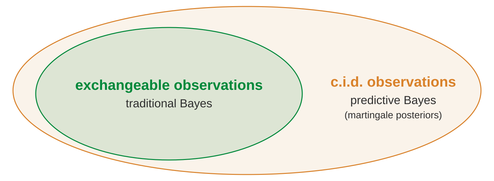

## The traditional Bayesian recipe

::: {style="padding-top: 1em"}
**Step 1 - Obtain the posterior via Bayesian rule**

$\displaystyle \pi(\theta \mid y_{1:n}) \;\propto\; \pi(\theta) \prod_{i=1}^{n} f(y_i \mid \theta)$
:::

::: {style="padding-top: 1em"}
**Step 2 - Average the likelihood over the posterior to predict new points**

$\displaystyle p(y_{n+1} \mid y_{1:n}) = \int f(y_{n+1} \mid \theta)\, \pi(\theta \mid y_{1:n})\, d\theta$
:::

::: {style="padding-top: 1em"}
**Known shortcomings of traditional Bayes**

- specification of prior $\pi(\theta)$ and likelihood $f(y_{n+1} \mid \theta)$ often challenging
- often computationally expensive approximations (e.g. MCMC) are necessary
:::

## Predictive Bayesian Inference
[In predictive Bayes a posterior is derived without specifying a prior or a likelihood]{.subtitle}

::: {style="padding-top: 2em; font-size: 0.85em"}
::: box
$$
\begin{array}{ccccccc}
  & & \mathclap{\textbf{Traditional Bayesian Inference}} & & & & \\[1em]
\underset{\text{likelihood}}{f(y \mid \theta)},\ \underset{\text{prior}}{\pi(\theta)}
  & \xrightarrow[\text{Bayes}]{\qquad\quad}
  & \underset{\text{posterior}}{\pi(\theta \mid y_{1:n})}
  & \xrightarrow[\text{predictive}]{\qquad\quad}
  & \underset{\text{posterior predictive}}{p(y \mid y_{1:n})}
  & & \\[-1.2em]
  & & \hphantom{\underset{\text{posterior}}{\pi(\theta \mid y_{1:n})}}
  & \hphantom{\xleftarrow[\text{impute new observations}]{\qquad\quad}}
  & \hphantom{\underset{\text{updated predictive}}{p(y \mid y_{1:n})}}
  & \hphantom{\xleftarrow[\text{observe } y_{1:n}]{\qquad\quad}}
  & \hphantom{\underset{\text{initial predictive}}{p(y)}}
\end{array}
$$
:::

::: {.box style="margin-top: 2em"}
$$
\begin{array}{ccccccc}
  & & & & \mathclap{\textbf{Predictive Bayesian Inference}} & & \\[1em]
  & & \underset{\text{posterior}}{\pi(\theta \mid y_{1:n})}
  & \xleftarrow[\text{impute new observations}]{\qquad\quad}
  & \underset{\text{updated predictive}}{p(y \mid y_{1:n})}
  & \xleftarrow[\text{observe } y_{1:n}]{\qquad\quad}
  & \underset{\text{initial predictive}}{p(y)} \\[-1.2em]
\hphantom{\underset{\text{likelihood}}{f(y \mid \theta)},\ \underset{\text{prior}}{\pi(\theta)}}
  & \hphantom{\xrightarrow[\text{Bayes}]{\qquad\quad}}
  & \hphantom{\underset{\text{posterior}}{\pi(\theta \mid y_{1:n})}}
  & \hphantom{\xrightarrow[\text{predictive}]{\qquad\quad}}
  & \hphantom{\underset{\text{posterior predictive}}{p(y \mid y_{1:n})}}
  & &
\end{array}
$$
:::
:::

::: {style="text-align: right; padding-top: 1.5em"}
[Diagram adapted from \[1\]]{.source}
:::

## Table of Contents

::: {.agenda style="padding-top: 1em"}
1. What is Bayesian uncertainty?
2. How does predictive Bayes reproduce traditional Bayes?
3. Can predictive Bayesian inference generalize from traditional Bayesian inference?
4. Practical Application
:::

## {.question data-q="1"}

Where does posterior uncertainty come from?

## Two Perspectives on Posterior Uncertainty
[Same posterior, different source of uncertainty]{.subtitle}

{.nostretch width=40% fig-align="center"}

:::: {.columns style="margin-top: 1em"}
::: {.column width="49%"}
::: box
[**Traditional Bayesian view**]{style="color: #2F2F2F"}

- $\theta$ is random, drawn from the prior $\pi$

$\Rightarrow$ **Source of uncertainty:** the parameter $\theta$
:::
:::
::: {.column width="2%"}
:::
::: {.column width="49%"}
::: box
[**Predictive Bayesian view**]{style="color: #2F2F2F"}

- $\theta = \theta(y_{1:\infty})$ is a function of the data

$\Rightarrow$ **Source of uncertainty:** missing observations
:::
:::
::::

## Doob's Theorem
[With infinitely many observations, the posterior mean converges to the $\Theta$ that generated the data]{.subtitle}

::: {.box style="margin-top: 2em"}
[**Theorem (Doob)** \[2\]]{style="color: #2F2F2F"}

Let $\Theta \sim \pi$ with $E[|\Theta|] < \infty$ and $Y_1, Y_2, \dots \mid \Theta \overset{iid}{\sim} f(\cdot \mid \Theta)$.

Under measurability and identifiability conditions on $f(\cdot \mid \theta)$,

$$
\bar\theta_N = E[\Theta \mid Y_{1:N}] \;\longrightarrow\; \Theta \quad \text{a.s.} \qquad \text{for } N \to \infty
$$
:::

::: {style="padding-top: 1em"}
::: fragment
- We only observe a fixed sample $y_{1:n}$ instead of an infinite sequence $Y_{1:\infty}$
:::

::: fragment
- Uncertainty about $\Theta$ stems entirely from the missing observations $Y_{n+1:\infty}$
:::

::: fragment
[Generate possible realizations of $Y_{n+1:\infty}$ to quantify uncertainty about $\Theta$ after observing $y_{1:n}$]{.then}
:::
:::

## Predictive resampling
[The missing observations $Y_{n+1:\infty}$ are simulated up to a large horizon $N$]{.subtitle}

::: {.box style="margin-top: 0.4em; font-size: 0.9em; --r-block-margin: 10px"}
[**Algorithm - Predictive Resampling**]{style="color: #2F2F2F"}

Input: observed data $y_{1:n}$, number of paths $B$, horizon $N > n$

Compute the initial predictive $P_n$ from $y_{1:n}$

For $b = 1, \dots, B$:

::: {style="padding-left: 1.5em"}
For $i = n+1, \dots, N$:

::: {style="padding-left: 1.5em"}
[[▷]{style="font-size: 0.7em; margin-right: 0.4em"}simulate the next observation]{style="float: right; width: 25em; text-align: left; color: #8C8C8C"}Sample $Y_i \sim P_{i-1}$

[[▷]{style="font-size: 0.7em; margin-right: 0.4em"}update the predictive with the new observation]{style="float: right; width: 25em; text-align: left; color: #8C8C8C"}Update $P_i \leftarrow \{P_{i-1}, Y_i\}$
:::

[[▷]{style="font-size: 0.7em; margin-right: 0.4em"}compute the parameter on the completed data]{style="float: right; width: 25em; text-align: left; color: #8C8C8C"}Evaluate $\theta_N^{(b)} = \theta(y_{1:n}, Y_{n+1:N})$
:::

Return $\theta_N^{(1)}, \dots, \theta_N^{(B)}$
:::

::: {style="padding-top: 0.3em"}
[Predictive resampling is utilized to express uncertainty about the parameter estimated from $y_{1:n}$]{.then}
:::

::: {style="text-align: right; padding-top: 0.1em"}
[Algorithm adapted from \[1\]]{.source}
:::

## Predictive Resampling Framework - Demonstration
[Each path imputes future data; the limits form the posterior]{.subtitle}

<iframe class="embed mp-steps" src="resources/martingale_posterior.html?embed&steps&v=2"></iframe>

<!-- each arrow press pops up the next stage: path 1, path 2, path 3, all paths -->
::: {style="display: none"}
[]{.fragment .mp-step}[]{.fragment .mp-step}[]{.fragment .mp-step}[]{.fragment .mp-step}
:::

```{=html}
<script>
window.addEventListener('load', () => {
  if (!window.Reveal) return;
  const sync = () => {
    const s = Reveal.getCurrentSlide();
    const fr = s && s.querySelector('iframe.mp-steps');
    if (!fr || !fr.contentWindow) return;
    const k = s.querySelectorAll('.mp-step.visible').length;
    fr.contentWindow.postMessage({ mpStep: k }, '*');
  };
  ['fragmentshown', 'fragmenthidden', 'slidechanged', 'ready'].forEach(ev => Reveal.on(ev, sync));
  document.querySelectorAll('iframe.mp-steps').forEach(fr => fr.addEventListener('load', sync));
});
</script>
```

## {.answer}

::: qa
[Where does posterior uncertainty come from?]{.asked}

[From the missing observations $Y_{n+1:\infty}$, which we can simulate using predictive resampling]{.then}
:::

## {.question data-q="2"}

How does predictive Bayes reproduce traditional Bayes?


# Making the predictive resampling framework explicit
[The framework is made explicit by three design choices]{.subtitle}

:::: {style="display: flex; align-items: stretch; gap: 3em; margin-top: 2em"}
::: {.box style="margin: 0; flex: 0 0 44%; box-sizing: border-box; font-size: 0.9em; --r-block-margin: 22px"}
[**Algorithm - Predictive Resampling**]{style="color: #2F2F2F"}

Compute $\textcolor{#00883A}{P_n}$ from $y_{1:n}$; choose $B$, $N$

For $b = 1, \dots, B$:

::: {style="padding-left: 1.5em"}
For $i = n+1, \dots, N$:

::: {style="padding-left: 1.5em"}
Sample $Y_i \sim P_{i-1}$

Update $\textcolor{#D9822B}{P_i \leftarrow \{P_{i-1}, Y_i\}}$
:::

Evaluate $\theta_N^{(b)} = \textcolor{#2F6DB5}{\theta}(y_{1:n}, Y_{n+1:N})$
:::

Return $\theta_N^{(1)}, \dots, \theta_N^{(B)}$
:::

::: {style="flex: 1; font-size: 0.9em; --r-block-margin: 0px; display: flex; flex-direction: column; justify-content: space-between; padding: 0.5em 0"}
[**Traditional Bayesian Inference**\
[with $\pi_i(\theta) := \pi(\theta \mid y_{1:n}, Y_{n+1:i})$]{style="font-weight: 400"}]{.fragment fragment-index="1"}

[**(1)** Initial Predictive Density]{style="color: #00883A"}\
[$\pi_n(\theta) \propto \prod_{j=1}^{n} f(y_j \mid \theta)\, \pi(\theta)$\
$p_n(y) = \int f(y \mid \theta)\, \pi_n(\theta)\, d\theta$]{.fragment fragment-index="1" style="color: #2F2F2F; display: inline-block; margin-top: 0.35em; line-height: 1.8; min-height: 3.6em"}

[**(2)** Update Rule for the Predictive Density]{style="color: #D9822B"}\
[$\pi_i(\theta) \propto f(Y_i \mid \theta)\, \pi_{i-1}(\theta)$\
$p_i(y) = \int f(y \mid \theta)\, \pi_i(\theta)\, d\theta$]{.fragment fragment-index="1" style="color: #2F2F2F; display: inline-block; margin-top: 0.35em; line-height: 1.8; min-height: 3.6em"}

[**(3)** Statistic of Interest]{style="color: #2F6DB5"}\
[$\theta_N = \bar\theta_N = \int \theta\, \pi_N(\theta)\, d\theta$ (posterior mean)]{.fragment fragment-index="1" style="color: #2F2F2F; display: inline-block; margin-top: 0.35em"}
:::
::::


## Predictive Resampling - Traditional Bayesian Inference
[With the Bayesian design choices, the endpoints recover the posterior $\pi(\theta \mid y_{1:n})$]{.subtitle}

<iframe class="embed" src="resources/martingale_posterior.html?embed&frozen&v=2" style="height: 560px"></iframe>

::: {style="padding-top: 0.6em"}
[Why does predictive resampling approximately recover the analytical posterior $\pi(\theta \mid y_{1:n})$?]{.then}
:::

## Equivalence of predictive Bayes with traditional Bayes
[De Finetti's representation theorem links traditional Bayesian inference to a predictive framework]{.subtitle}

- **Exchangeability:** $p(y_1, \dots, y_n) = p(y_{\sigma(1)}, \dots, y_{\sigma(n)})$ for all $n$ and every reordering $\sigma$
- **de Finetti \[4\]:** infinite exchangeable sequences of observations have an implicit prior $\times$ likelihood
- Bayesian posterior predictive makes the imputed sequence $Y_{n+1}, Y_{n+2}, \dots$ exchangeable

::: {.box style="padding: 0.4em 1em 0.3em; margin-top: 0.8em"}
$$
\underbrace{\prod_{i=n+1}^{N} p(y_i \mid y_{1:i-1})}_{\mathclap{\substack{\text{predictive rule} \\ \textcolor{#8C8C8C}{\text{(Bayesian posterior predictive)}}}}}
\;=\; \underbrace{p(y_{n+1}, \dots, y_N \mid y_{1:n})}_{\text{joint probability of missing data}}
\;\overset{\substack{Y_{n+1}, Y_{n+2}, \dots \\ \text{exchangeable}}}{\rule{0pt}{0.95em}=}\;
\underbrace{\int \prod_{i=n+1}^{N} f(y_i \mid \theta)\, \pi(\theta \mid y_{1:n})\, d\theta}_{\text{posterior} \,\times\, \text{likelihood}}
$$
:::

[Predictive rule produces $Y_{n+1:N}$, yielding $\bar\theta_N = \mathbb{E}[\Theta \mid y_{1:n}, Y_{n+1:N}] \overset{\text{a.s.}}{\longrightarrow} \Theta \sim \pi(\theta \mid y_{1:n})$ via Doob \[2\]]{.then}

## {.answer}

::: qa
[How does predictive Bayes reproduce traditional Bayes?]{.asked}

[Bayesian posterior predictive as the predictive rule]{.then}

[Generated sequence $Y_{n+1}, Y_{n+2}, \dots$ becomes **exchangeable**, implying an underlying prior $\times$ likelihood representation, so the traditional Bayesian posterior is recovered]{.then}
:::

## {.question data-q="3"}

Can predictive Bayesian inference generalize from traditional Bayesian inference?

## Requirements for a valid posterior
[The predictives must converge, and their limit must stay centred on $P_n$]{.subtitle}

- Specify 1-step-ahead predictive distributions without requiring an implicit prior $\times$ likelihood representation

  $$
  P_i(y) = P(Y_{i+1} \le y \mid y_{1:i}) \qquad i = n, n+1, \dots
  $$

[Predictive resampling still produces a distribution for $\theta$, but now its validity is no longer guaranteed by Bayes' theorem]{.then}

- **Predictive coherence** \[1\]: when the sequence of predictives $P_i(y)$ fulfils these two conditions, predictive resampling yields a valid posterior

:::: {.columns style="margin-top: 0.6em"}
::: {.column width="49%"}
::: {.box style="height: 100%; box-sizing: border-box; margin: 0"}
[**Condition 1 (Existence)**]{style="color: #2F2F2F"}

$P_{n+1}(y), P_{n+2}(y), \dots$ converges almost surely to a random distribution function $P_\infty(y)$
:::
:::
::: {.column width="2%"}
:::
::: {.column width="49%"}
::: {.box style="height: 100%; box-sizing: border-box; margin: 0"}
[**Condition 2 (Unbiasedness)**]{style="color: #2F2F2F"}

$E[P_\infty(y) \mid y_{1:n}] = P_n(y)$
:::
:::
::::

## What the two conditions rule out
[If existence fails the paths never settle, and if unbiasedness fails they settle away from $\bar\theta_n$]{.subtitle}

::: {style="padding-top: 1.2em"}
{.nostretch width=100% fig-align="center"}
:::

[What do the predictive distributions themselves converge to?]{.then}

## From the predictive to the martingale posterior
[Under c.i.d., predictive $P_N$ and empirical $F_N$ share the same limit $P_\infty = F_\infty$ \[5\]]{.subtitle}

<iframe class="embed mp-steps" src="resources/pf_limit.html?steps&v=16"></iframe>

::: {style="display: none"}
[]{.fragment .mp-step}[]{.fragment .mp-step}[]{.fragment .mp-step}[]{.fragment .mp-step}[]{.fragment .mp-step}[]{.fragment .mp-step}[]{.fragment .mp-step}[]{.fragment .mp-step}
:::

## Martingale posterior
[The martingale posterior is induced by the distribution of the random distribution function $F_\infty$ given the observed data]{.subtitle}

::: {.box style="margin-top: 1.5em"}
[**Definition (martingale posterior)** \[1\]]{style="color: #2F2F2F"}

$$
\Pi_\infty(\theta_\infty \le t \mid y_{1:n}) = \int \mathbb{1}\{\theta(F_\infty) \le t\}\; d\Pi(F_\infty \mid y_{1:n})
$$
:::

::: {.sub-bullets style="padding-left: 1.5em"}
- $F_\infty$: empirical distribution of the completed dataset $\{y_{1:n}, Y_{n+1:\infty}\}$ with simulated $Y_{n+1:\infty}$
- $\Pi(F_\infty \mid y_{1:n})$: distribution of $F_\infty$ given the observed data, implied by the predictives
:::

- In practice we stop at a finite horizon $N$:

$$
\Pi_N(\theta_N \le t \mid y_{1:n}) = \int \mathbb{1}\{\theta(F_N) \le t\}\; p(y_{n+1:N} \mid y_{1:n})\, dy_{n+1:N}
$$

[Which predictive sequences $P_n, P_{n+1}, \dots$ achieve predictive coherence?]{.then}

## Martingale property
[The key criterion for the choice of the predictive rule is the martingale property \[7\]]{.subtitle}

:::: {.columns style="padding-top: 0.4em"}
::: {.column width="46%"}
::: box
[**Predictives form a martingale**]{style="color: #2F2F2F"}

$E[P_i(y) \mid y_{1:i-1}] = P_{i-1}(y) \;\; \forall y$

[Given the data so far, the predictive is not expected to move in any particular direction]{style="font-size: 0.85em; color: #626468"}
:::
:::
::: {.column .fragment fragment-index="2" style="width: 8%; text-align: center; font-size: 1.8em; padding-top: 1.1em"}
$\Leftrightarrow$
:::
::: {.column width="46%"}
::: {.box .fragment fragment-index="2"}
[**c.i.d. sequence of observations** \[5\]]{style="color: #2F2F2F"}

$P(Y_{i+k} \le y \mid y_{1:i}) = P_i(y) \;\; \forall k \ge 1$

[**Conditioned** on the data $y_{1:i}$, each new observation $Y_{i+1}, Y_{i+2}, \dots$ has **identical** **distribution** $P_i$]{style="font-size: 0.85em; color: #626468"}
:::
:::
::::

:::: {.columns style="margin-top: -0.6em"}
::: {.column style="width: 46%; box-sizing: border-box"}
::: {.fragment fragment-index="1" style="text-align: center; font-size: 1.8em; line-height: 1; margin: 0.1em 0"}
$\Downarrow$
:::
::: {.box .fragment fragment-index="1"}
[**Predictive coherence**]{style="color: #2F2F2F"}

$P_\infty$ exists and $E[P_\infty \mid y_{1:n}] = P_n$

$\Rightarrow$ resulting martingale posterior is a valid posterior \[1, 5\]
:::
:::
::: {.column style="width: 54%; box-sizing: border-box"}
&nbsp;
:::
::::

## Implications for generalization capabilities
[Every exchangeable sequence is c.i.d., but not every c.i.d. sequence is exchangeable]{.subtitle}

- Predictive Bayes imposes a weaker condition on the predicted observations for obtaining valid posteriors
- c.i.d. observations don't need to be exchangeable as in traditional Bayes

{.nostretch width=62% fig-align="center"}

[Given that the predictive rule keeps the martingale property, valid posteriors can be acquired without an implicit prior $\times$ likelihood representation]{.then}

## {.answer}

::: qa
[Can predictive Bayesian inference generalize from traditional Bayesian inference?]{.asked}

[Valid posteriors can be acquired as long as the framework is predictively coherent]{.then}

[Update rules whose predictives form a martingale yield valid posteriors without a prior $\times$ likelihood setup]{.then}
:::

## {.question data-q="4"}

Practical applications of predictive Bayesian inference

## Practical Implications of Predictive Bayes

**Advantages**

- Only the predictive rule needs to be designed, so no prior $\times$ likelihood has to be chosen (or misspecified)
- Bayesian learning happens by updating the predictive with each new observation, without requiring latent parameters or exchangeability

[Formulate a predictive rule satisfying the martingale property and test it on the observed data]{.then}

**Caveats**

- Specifying a sensible predictive rule is often challenging
- Prior assumptions are still encoded in the initial guess $p_0$ and the choice of update rule $\{p_i, y_{i+1}\} \mapsto p_{i+1}$

## Brainstorming
[Options for the practical example]{.subtitle}

::: {style="font-size: 0.78em; margin-top: 0.4em"}
|  | **Example** | **Pros** | **Cons** |
|--|-------|--------|--------|
| **1** | Bootstrapping / Pólya urn \[1, 6\] | <span class="pm">+ computationally easy</span><span class="pm">+ close to the papers (many of them name it)</span> | <span class="pm">– personally not that interesting</span><span class="pm">– rest of the presentation is already close to the papers</span> |
| **2** | Copula update as in \[1\], Sections 4.1–4.2 | <span class="pm">+ relevant method for martingale posterior approximation</span><span class="pm">+ focused</span> | <span class="pm">– again close to the Fong et al. paper</span><span class="pm">– in the end shows what was shown before: posteriors can be obtained more cheaply</span><span class="pm">– hyperparameters (e.g. copula bandwidth $\rho$) need to be discussed to some extent</span> |
| **3** | Copula update for uncertainty quantification of PFNs \[9\] | <span class="pm">+ very interesting</span><span class="pm">+ shows how it is used in an applied domain</span> | <span class="pm">– maybe too convoluted at the end of the talk</span><span class="pm">– students probably don't know PFNs (does someone present topic 7?)</span><span class="pm">– hyperparameters (e.g. copula bandwidth $\rho$) need to be discussed to some extent</span> |
| **4** | Parametric martingale posterior with score-based updates \[7, 8\] | <span class="pm">+ unrelated to the Fong et al. (2023) paper</span> | <span class="pm">– score-based machinery needs to be introduced</span> |
| **5** | Variational predictive resampling \[3\] | <span class="pm">+ interesting approach and more practical application (improves variational inference)</span> | <span class="pm">– relies on a.c.i.d. assumptions</span><span class="pm">– variational inference itself needs to be introduced, takes long</span> |
:::

## Notes & Questions

- Is the theory part too dense?
- Does reusing one running example (slides 9, 13, 19) feel repetitive?
- Should parametric update rules (score-based martingale posteriors \[7, 8\]) be covered as well?
- Should the generalization from exchangeable to c.i.d. sequences get more emphasis?

# What are the implications?
## Backup: Predictive Resampling (with predictive densities) {visibility="uncounted"}
[Original demo: path 1 pauses after 25 observations; hover shows the predictive density]{.subtitle}

<iframe class="embed" src="resources/martingale_posterior_full.html?embed&v=2"></iframe>

## Backup: Exchangeability in predictive resampling {visibility="uncounted"}
[Reordering the imputed observations changes the path, but not the endpoint $\bar\theta_N$]{.subtitle}

<iframe class="embed" src="resources/exchangeability_shuffle.html" style="height: 560px"></iframe>

## Backup: Two valid predictive update rules {visibility="uncounted"}
[Same random draws, different learning rate $\alpha_k$: both valid, only one Bayesian]{.subtitle}

<iframe class="embed mp-steps" src="resources/cid_rates.html?steps"></iframe>

::: {style="display: none"}
[]{.fragment .mp-step}[]{.fragment .mp-step}
:::

## Backup: How the classes of sequences are nested {visibility="uncounted"}
[i.i.d. $\subset$ exchangeable $\subset$ c.i.d.: each step outward drops one restriction, a valid posterior remains]{.subtitle}

{.nostretch width=88% fig-align="center"}

## Backup: Martingale posterior (limit definition) {visibility="uncounted"}
[Definition 1 of \[1\]: the limit of the finite martingale posterior]{.subtitle}

::: {.box style="margin-top: 1.5em"}
[**Definition (martingale posterior)** \[1\]]{style="color: #2F2F2F"}

$$
\Pi_\infty(\theta_\infty \le t \mid y_{1:n}) = \int \mathbb{1}\{\theta(F_\infty) \le t\}\; d\Pi(F_\infty \mid y_{1:n})
$$
:::

- $F_\infty$: empirical distribution of the completed dataset $\{y_{1:n}, Y_{n+1:\infty}\}$
- Under c.i.d., $F_\infty = P_\infty$ almost surely, so $\theta(F_\infty) = \theta(P_\infty)$ \[1, 5\]

## Backup: The martingale property is sufficient, but not necessary {visibility="uncounted"}


## References {visibility="uncounted"}

::: {style="font-size: 0.62em; line-height: 1.35; padding-top: 0.6em"}
\[1\] Fong, E., Holmes, C. & Walker, S. G. (2023). Martingale posterior distributions. *Journal of the Royal Statistical Society Series B*, 85(5), 1357–1391.

\[2\] Doob, J. L. (1949). Application of the theory of martingales. *Le Calcul des Probabilités et ses Applications*, Colloques Internationaux du CNRS 13, 23–27.

\[3\] Battaglia et al. (2026). Variational predictive resampling. *arXiv:2605.11168*.

\[4\] de Finetti, B. (1937). La prévision : ses lois logiques, ses sources subjectives. *Annales de l'Institut Henri Poincaré*, 7(1), 1–68.

\[5\] Berti, P., Pratelli, L. & Rigo, P. (2004). Limit theorems for a class of identically distributed random variables. *The Annals of Probability*, 32(3), 2029–2052.

\[6\] Rubin, D. B. (1981). The Bayesian bootstrap. *The Annals of Statistics*, 9(1), 130–134.

\[7\] Holmes, C. C. & Walker, S. G. (2023). Statistical inference with exchangeability and martingales. *Philosophical Transactions of the Royal Society A*, 381(2247), 20220143.

\[8\] Fong, E. & Yiu, A. (2026). Asymptotics for a class of parametric martingale posteriors. *Biometrika*. arXiv:2410.17692.

\[9\] Nagler, T. & Rügamer, D. Uncertainty quantification for prior-data fitted networks using martingale posteriors. *arXiv:2505.11325*.
:::
